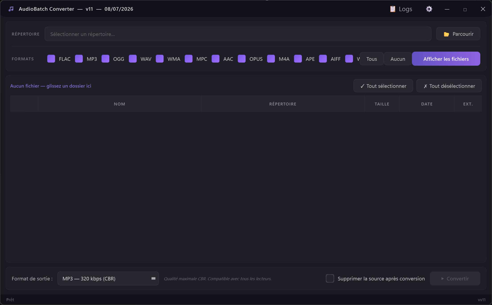

# 🎵 AudioBatch Converter

**Batch-convert your music library — FLAC, WAV, APE, OGG, M4A and more to MP3, OGG or Opus — with tags and cover art preserved.**

Point it at a folder: it scans everything, converts in parallel through FFmpeg, keeps your metadata and embedded artwork, and can even fill in missing tags for you.



## Features

- **Batch conversion** of a whole folder tree, in parallel (all CPU cores).
- **Formats**: FLAC, WAV, APE, OGG, M4A, WMA, AIFF… → MP3, OGG, Opus, and more, with per-format quality settings.
- **Tags & cover art preserved** through conversion (mutagen + FFmpeg).
- **Tag editor** with batch editing, filename-pattern deduction (`Artist - Title`…), and **MusicBrainz auto-tagging** (official API, rate-limit friendly).
- **Preview player** to check files before/after.
- **FFmpeg auto-setup**: on first run the app offers to download FFmpeg (BtbN build) — nothing to install manually, nothing bundled in this repository.
- Dark themed PyQt6 UI, detailed logs window.

## Installation

Requires **Windows** and **Python 3.12+**.

```bash
git clone https://github.com/hypedigger/AudioBatch-Converter.git
cd AudioBatch-Converter
pip install -r requirements.txt
python main.py
```

On first launch, accept the FFmpeg download (or point the app at an existing FFmpeg).

## Usage

1. Choose your music folder — the scanner lists every convertible file.
2. Pick the output format and quality.
3. Convert. Covers and tags follow automatically.
4. Optional: open the tag editor to fix metadata, or let MusicBrainz fill the gaps.

Settings and logs are local files (`config.json`, `logs/`) and are not part of the repository.

## Notes

- Conversion only touches **your local files** — nothing is downloaded from or uploaded to any music service.
- FFmpeg is GPL; it is downloaded separately from [BtbN/FFmpeg-Builds](https://github.com/BtbN/FFmpeg-Builds) and never redistributed here.
- MusicBrainz lookups follow their [API etiquette](https://musicbrainz.org/doc/MusicBrainz_API/Rate_Limiting) (identified User-Agent, 1 request/s).
- UI is currently in French; contributions welcome.

## Support

If AudioBatch Converter saved your library migration:

[](https://ko-fi.com/hypedigger)

## License

[MIT](LICENSE)
